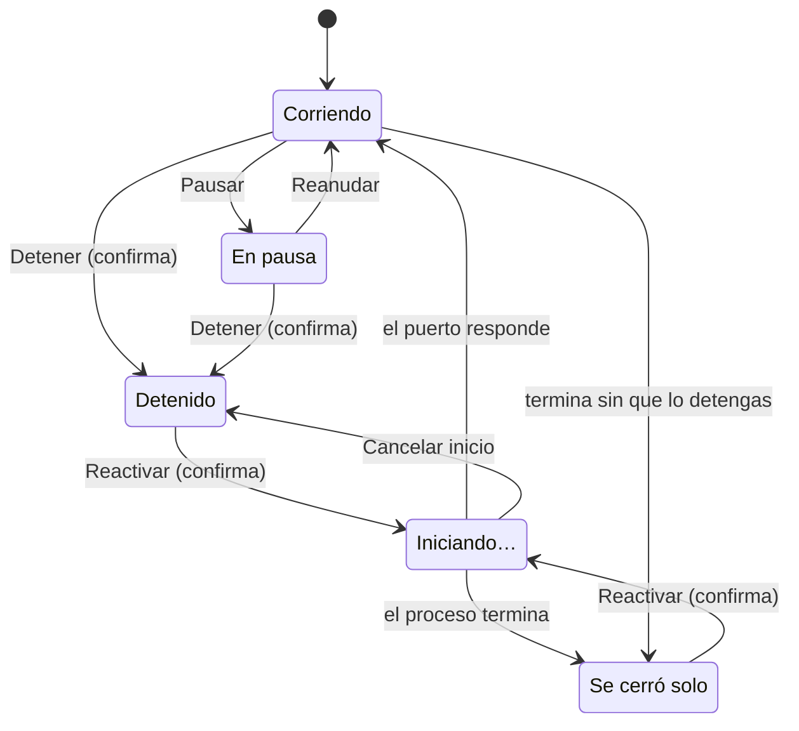

# Servidores

La vista **Servidores** muestra los programas de tu computadora que escuchan en un puerto TCP. Marca en amarillo los que cualquier equipo de tu red WiFi puede abrir, y te deja abrirlos, pausarlos, detenerlos y reactivarlos sin salir de Qubbot.

- Spec: [`spec/001-running-servers.md`](../../../spec/001-running-servers.md)
- Rama: `feature/server`

## Cómo se usa

Abre la app (`npm start`) y toca el ícono **Servidores** en la barra flotante, entre Reparaciones y Conecta tu agente. La lista se actualiza cada 3 segundos mientras el panel está abierto; con el panel cerrado, Qubbot no consulta al sistema.

Cada fila tiene:

| Parte | Qué muestra |
|---|---|
| Etiqueta | "Solo esta computadora", o "Visible en tu red" en amarillo. Al pasar el mouse explica el riesgo. |
| `:puerto · proceso` | El puerto y el nombre del programa. Nunca su línea de comandos, que puede tener contraseñas. |
| ■ o ▶ | Detener (pide confirmación), o Reanudar si está en pausa. |
| ⋯ | Las demás acciones. |

El menú ⋯ de un servidor que está corriendo ofrece:

- **Abrir con**: el navegador predeterminado, cada navegador instalado que Qubbot reconoce (Safari, Chrome, Firefox, Edge, Brave, Arc, Opera, Vivaldi y Chromium) o "Elegir otra app…".
- **Ver salida**: solo en los servidores que inició Qubbot. El panel se cierra con su ×.
- **Pausar**: congela el proceso. El puerto sigue ocupado y el servidor no responde hasta que lo reanudes.
- **Detener…**: cierra el proceso después de confirmar.

## Estados



| Estado | Dónde aparece | Acciones |
|---|---|---|
| Corriendo | Lista principal | Abrir, Pausar, Detener. Ver salida si tiene la etiqueta **En Qubbot**. |
| En pausa | Lista principal, con la etiqueta "En pausa" | Reanudar (▶), Detener |
| Detenido | Detenidos desde Qubbot | Reactivar (▶), Ver salida, Quitar de la lista |
| Iniciando… | Detenidos desde Qubbot | Cancelar inicio (■), Ver salida |
| Se cerró solo | Detenidos desde Qubbot, con su código de salida | Reactivar, Ver salida, Quitar de la lista |

"Se cerró solo" solo puede pasar con servidores que inició Qubbot. Si cierras un servidor desde tu terminal, desaparece de la lista y Qubbot no lo registra.

## Reactivar

Reactivar vuelve a iniciar el servidor dentro de Qubbot, en segundo plano, sin abrir ninguna ventana de Terminal:

1. Qubbot pide confirmación y muestra la carpeta y el comando, con las contraseñas y los tokens ocultos.
2. Si el puerto ya está ocupado por otro programa, avisa y no inicia nada.
3. La fila pasa a "Iniciando…" hasta que algo escuche en ese puerto.
4. El servidor vuelve a la lista con la etiqueta **En Qubbot**. Lo que imprime está en ⋯ › Ver salida: las últimas 300 líneas, sin colores.
5. Si el proceso termina solo, vuelve a Detenidos como "Se cerró solo · código N", con su error en Ver salida.

Puedes detenerlo y reactivarlo las veces que quieras, porque Qubbot guarda el comando y la carpeta con que lo inició.

Límites:

- Solo funciona en macOS. Windows no expone la carpeta de trabajo de otro proceso, y reabrir el comando en otra carpeta serviría otra cosa.
- Qubbot lee el comando con `ps` como texto y lo separa por espacios. Si un argumento tiene espacios, el servidor no arranca bien.
- Los programas que cambian su nombre de proceso (por ejemplo, `next-server`) no muestran su comando real: al reactivarlos se cierran solos, y Ver salida muestra el error.
- Las variables que exportaste en la terminal original no se copian. El servidor arranca con tu shell de inicio de sesión (zsh o bash), así que sí tiene tu `PATH`, nvm o pyenv.
- La lista de Detenidos vive en memoria y se pierde al cerrar la app.
- Al cerrar Qubbot se detienen los servidores que inició, porque no tienen terminal y quedarían escuchando sin que nadie los vea. Los que pausó, los reanuda.

## Seguridad

La vista toca procesos del sistema, así que sigue las reglas del resto de Qubbot:

- **La ventana nunca manda un pid, una URL, un comando ni una ruta de programa.** Solo manda un puerto, el id de un navegador conocido o el id de una fila de Detenidos. El proceso principal resuelve el resto y valida cada pedido.
- **Sin shell.** Los comandos del sistema van con `execFile`, rutas absolutas, argumentos fijos y un límite de 5 segundos.
- **Detener y Reactivar piden confirmación** en un diálogo nativo, con Cancelar por defecto. Después del diálogo, Qubbot vuelve a leer la lista y solo cierra los procesos que siguen en ese puerto, para no tocar un pid que el sistema haya reutilizado.
- **Procesos protegidos.** Nunca detiene ni pausa a Qubbot ni a los procesos del sistema (pid 0, 1 y 4), y nunca pide `sudo`. En macOS, sin permisos de administrador, solo ve los procesos de tu usuario.
- **Reactivar no interpreta el comando.** Lo ejecuta un script fijo, `exec "$@"`, que recibe las palabras como argumentos, así que `$`, `;`, `|` y los backticks no se interpretan.
- **Abrir arma la URL en el proceso principal**: `http://localhost:<puerto>`, con el puerto validado entre 1 y 65535.
- **Auditoría.** Cada apertura, detención, pausa, reanudación y reactivación queda en el registro de auditoría, igual que un servidor que se cierra solo.

## Plataformas

| | macOS | Windows | Demo web |
|---|---|---|---|
| Lista y semáforo | `lsof` | `netstat` y `tasklist` | Servidores de ejemplo |
| Abrir con… | Sí | Sí | No |
| Pausar y reanudar | `SIGSTOP` / `SIGCONT` | `NtSuspendProcess` vía PowerShell | No |
| Detener | Sí | Sí | No |
| Reactivar | Sí | No | No |

La parte de Windows está cubierta con tests sobre salidas de ejemplo de `netstat` y `tasklist`, pero nadie la probó todavía en un Windows real (decisión abierta D7 en la spec).

## Cómo está armado

```
shellView → ServersViewModel → ServersModel → serverService → window.platanus.servers ──IPC──→ main.js → servers.js
```

| Archivo | Qué hace |
|---|---|
| `electron/servers.js` | Lee los puertos, arma las filas, detiene, pausa, reactiva y guarda la lista de Detenidos. No depende de Electron, así que se prueba con Node. |
| `electron/main.js` | Canales IPC `servers:*`, diálogos de confirmación, auditoría y cierre ordenado al salir. |
| `electron/preload.js` | Expone `window.platanus.servers` a la ventana. |
| `electron/strings.js` | Textos del proceso principal: diálogos y errores. |
| `renderer/services/serverService.js` | Puente con Electron. En el navegador devuelve servidores de ejemplo. |
| `renderer/models/serversModel.js` | Datos y reglas: valida las filas, asigna el semáforo (expuesto = amarillo) y ordena. |
| `renderer/viewmodels/serversViewModel.js` | Estado de pantalla: consulta cada 3 segundos, menú abierto, acciones en curso, avisos y panel de salida. |
| `renderer/views/ui/shellView.js` | Dibuja las filas y la sección Detenidos. |
| `renderer/views/ui/floatingMenu.js` | El menú ⋯: una capa flotante anclada a su botón que se abre hacia arriba si no cabe y se maneja con teclado. |
| `renderer/i18n/es.js` | Textos de la vista. |
| `renderer/styles/shell.css` | Estilos `.server-*`, `.icon-btn` y `.floating-menu*`. |

### Canales IPC

Si una acción falla, el canal responde `{ ok: false, code, error }`, con `error` en español.

| Canal | Recibe | Devuelve | Pide confirmación |
|---|---|---|---|
| `servers:list` | nada | `[{ port, process, address, exposed, paused, managed }]` | No |
| `servers:browsers` | nada | `[{ id, name }]` | No |
| `servers:open` | puerto, id de navegador (`default`, `other` o uno instalado) | la URL abierta | No. Con `other`, la persona elige la app en un diálogo. |
| `servers:stop` | puerto | `{ port, processes }` | Sí |
| `servers:pause`, `servers:resume` | puerto | `{ port, processes }` | No |
| `servers:stopped` | nada | `[{ id, port, process, canRestart, state, exitCode, hasOutput, at }]` | No |
| `servers:restart` | id de Detenidos | `{ port, process }` | Sí |
| `servers:cancelStart` | id de Detenidos | nada | No |
| `servers:forget` | id de Detenidos | nada | No |
| `servers:output` | puerto o id de Detenidos | texto | No |

## Pruebas

```bash
npm test
```

Los tests de esta vista están en:

- `electron/servers.test.js`: lectura de `lsof`, `netstat` y `tasklist`, exposición a la red, abrir, detener, pausar, reactivar, la lista de Detenidos y la salida.
- `tests/renderer/serversViewModel.test.mjs`: modelo y view model con un servicio falso y `mock.timers`.
- `tests/renderer/floatingMenu.test.mjs`: dónde se abre el menú ⋯.

Prueba manual en macOS, con una terminal para cada comando:

1. `npx electron . --dev`
2. `python3 -m http.server 8000`: aparece en amarillo, "Visible en tu red".
3. `python3 -m http.server 8001 --bind 127.0.0.1`: aparece como "Solo esta computadora".
4. En la fila 8000, toca ■ y confirma: pasa a Detenidos. Toca ▶ y confirma: pasa a "Iniciando…" y vuelve a la lista con **En Qubbot**. Repite el ciclo una vez más.
5. En la fila 8001, ⋯ › Pausar: `curl -m 1 localhost:8001` no responde. Toca ▶ y vuelve a responder.

Las decisiones que se tomaron por defecto y las que siguen abiertas están en la sección "Decisiones abiertas" de la spec.
